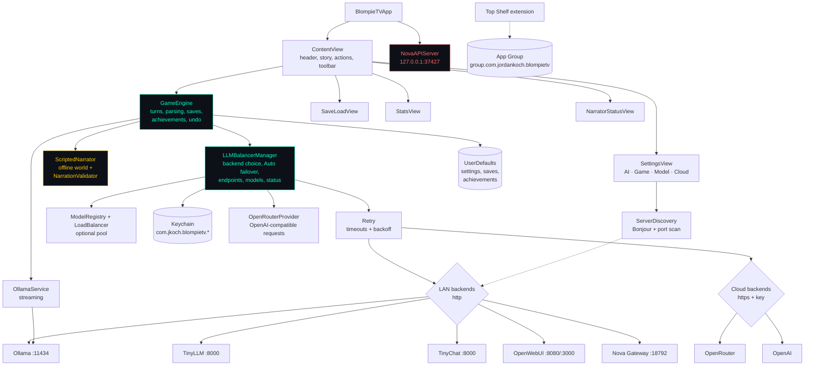
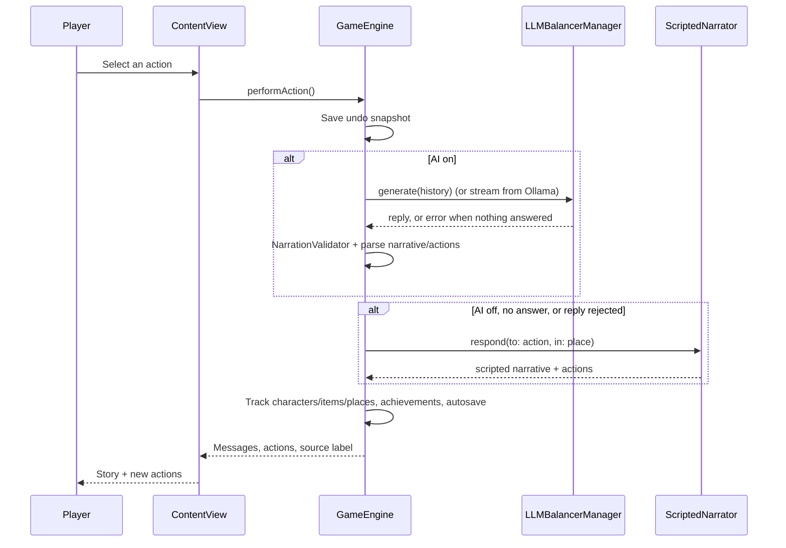
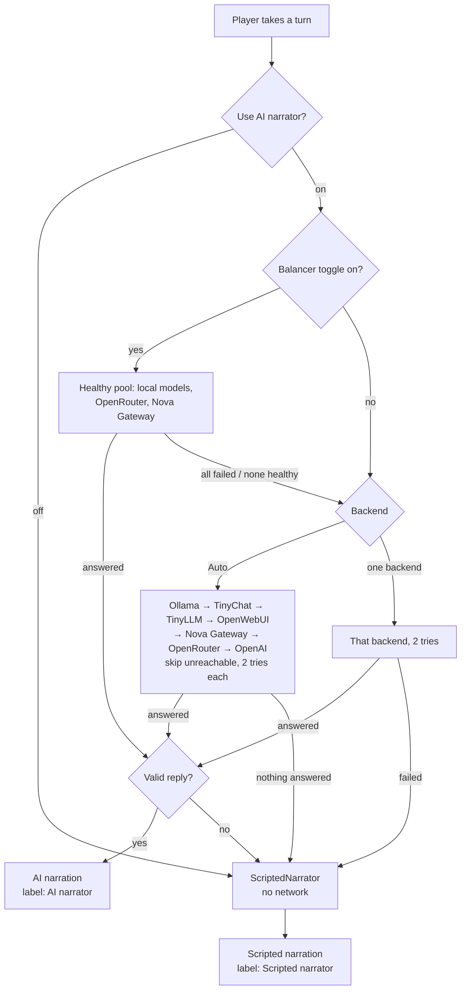

# BlompieTV


[](https://opensource.org/licenses/MIT)


BlompieTV is a Zork-style text adventure for Apple TV. A language model narrates the world as you play: you pick an action with the Siri Remote and the story moves on. The model can run on your own network (Ollama, TinyLLM, TinyChat, OpenWebUI, Nova Gateway) or in the cloud (OpenRouter, OpenAI) with your own key. With no AI reachable, or with AI switched off, a built-in scripted narrator keeps the game playable.

Written by Jordan Koch. Current version: **1.1.0 (build 2)**. See [CHANGELOG.md](CHANGELOG.md).

---

## Contents

- [Features](#features)
- [Architecture](#architecture)
- [AI options](#ai-options)
- [Requirements](#requirements)
- [Install and build](#install-and-build)
- [Setup](#setup)
- [Playing](#playing)
- [Local API for Nova](#local-api-for-nova)
- [Project structure](#project-structure)
- [Tests](#tests)
- [Known limitations](#known-limitations)
- [Credits](#credits)

---

## Features

### Story
- The AI acts as game master: it describes each scene and offers 2 to 4 actions, favouring characters to talk to, trade with and help over combat.
- **Detail level** (Brief, Normal, Detailed) and **tone** (Serious, Balanced, Whimsical) change the system prompt.
- **Creativity** (temperature) from 0.1 to 2.0.
- **Streaming**: with Ollama, text appears as it is generated, with a tokens-per-second readout.
- **Random Model Mode** switches to another installed model every 3, 5, 10 or 15 actions.
- **Scripted narrator**: a small hand-written world of 8 connected places (meadow, crossroads, bell tower, market, library, river, grove, observatory) with its own characters and items. It tells every turn when AI is off and fills in for any turn where the AI doesn't answer.

### AI backends
- **Auto** (default), **Ollama**, **TinyLLM**, **TinyChat**, **OpenWebUI**, **Nova Gateway**, **OpenRouter**, **OpenAI**.
- Global **Use AI narrator** switch, editable endpoint URLs, a model per backend, and network discovery of Ollama/OpenWebUI servers.
- Auto mode fails over across reachable backends in a fixed order, with timeouts and bounded retries.
- Optional load balancing across all local models, all OpenRouter models and Nova Gateway.
- Status in the header: which backend is narrating, whether it's reachable, and whether the last turn came from the AI or the scripted narrator.
- API keys stay in the Apple TV Keychain and are only sent over https.

Details are in [AI options](#ai-options).

### Game
- Tracks the characters you meet, items you pick up and places you visit, parsed from the narration.
- 10 achievements: First Steps, Explorer, World Traveler, Social Butterfly, Diplomat, Collector, Hoarder, Conversationalist, Veteran Adventurer, Trader.
- **Undo** up to 20 turns.
- Transcript export.

### Saving
- Named save slots with date and message count, load, delete and delete-all.
- Autosave after every turn (can be turned off).
- Saves remember where you are in the scripted world.

### Stats
- **Stats** tab: token speed, model, streaming, actions, messages, saves, characters, items, places, and current detail/tone/creativity.
- **Achievements** tab with unlock dates.
- **Inventory** tab.

### Apple TV interface
- Built for the Siri Remote: focus-based navigation, large buttons, nothing that needs a keyboard to play.
- Story on the left, actions on the right, toolbar at the bottom.
- Monospaced text from 20 to 48 pt, dark gradient with a grid, cyan accents.
- Settings tabs: **AI**, **Game**, **Model**, **Cloud**.

### Top Shelf
- A Top Shelf extension shows a **New Adventure** item on the Apple TV home screen. See [Known limitations](#known-limitations) for the save and stats items.

### Local API
- Loopback-only HTTP API on port 37427 (`/api/status`, `/api/ping`) for Nova and local tools.

---

## Architecture



### A turn



---

## AI options



| Setting | Where | Notes |
|---|---|---|
| **Use AI narrator** (on/off) | Settings > AI | Off: every turn comes from the scripted narrator and nothing is sent over the network. |
| **Backend** | Settings > AI | Auto, Ollama, TinyLLM, TinyChat, OpenWebUI, Nova Gateway, OpenRouter, OpenAI. MLX is macOS-only and isn't offered on tvOS. |
| **Endpoints** | Settings > AI | An editable URL for each local backend, Nova Gateway and the OpenAI base URL. Defaults are `localhost`, which on an Apple TV means the TV itself, so enter your server's LAN address. |
| **Discover Servers** | Settings > AI | Bonjour (`_http._tcp`) plus a scan of 192.168.0.x, 192.168.1.x and 10.0.0.x for Ollama (11434) and OpenWebUI (3000/8080/8000). **Use** fills in the URL and selects that backend. |
| **Model** | Settings > Model | Lists the models of the selected backend (in Auto, the one that answered last). |
| **Load balancing** | Settings > Cloud | Optional, off by default: all local Ollama models, all OpenRouter models, Nova Gateway. If the pool fails, the backend chosen in the AI tab is used. |
| **API keys** | Settings > Cloud | OpenRouter and OpenAI. See below. |

**Scripted fallback.** If AI is on but no backend answers (timeout, error, nothing reachable) or the reply fails the checks below, the scripted narrator tells that turn instead. The turn is never lost and no error dialog appears. Scripted text isn't fed back to the model.

**Status.** The header shows a dot and a line: green "Narrator: Ollama online", orange "AI unreachable - scripted fallback" or grey "AI off - scripted narrator". Under it: "Last turn: AI narrator (Ollama)" or "Last turn: Scripted narrator (...)". Settings > AI shows the same status, a health dot for each backend, and **Test Connection**.

**Timeouts and retries.** Health checks time out after 4 s and are reused for 30 s. Story requests time out after 120 s. Each backend gets at most 2 attempts with a 0.5 s pause, and only temporary errors (network errors, HTTP 408/429/5xx) are retried.

**Reply checks.** Before a reply touches the game: hidden `<think>` reasoning and control characters are removed; empty or non-text replies, and replies that repeat the system prompt, are rejected; text is capped at 6,000 characters; actions are capped at 6 of 80 characters each, with markdown and duplicates removed. A reply with no story text is rejected.

**API keys.** OpenRouter and OpenAI keys are stored only in the Apple TV Keychain, under `com.jkoch.blompietv.openrouter` and `com.jkoch.blompietv.openai`, never in UserDefaults or files. A request carrying a key is refused unless the URL is `https://`. Keys are never sent to local backends, and status checks don't call the cloud. Keys saved by earlier builds (`com.jkoch.aistudio.openrouter`, `com.jordankoch.BlompieTV.openrouter`, `com.jordankoch.BlompieTV.openai`) are moved to the new names on first launch and the old items deleted.

**Entering a key on Apple TV.** In Settings > Cloud, select the key field and tvOS opens its on-screen keyboard. Typing a long key with the remote is slow, so use an iPhone signed in to the same Apple Account: while the field is focused, the iPhone shows an "Apple TV Keyboard" notification (or open the Apple TV Remote in Control Center), where you can type or paste the key. Press **Save**. **Clear** removes the key from the Keychain.

**Claude.** Use Nova Gateway or OpenRouter (for example `anthropic/claude-sonnet-4.5`). There is no separate Anthropic backend. Google Cloud, Azure, AWS and IBM Watson aren't offered: in Jordan's other apps they were stubs or broken and never worked.

---

## Requirements

### To play
- Apple TV 4K or Apple TV HD, tvOS 17.0 or later.
- Optional: an AI backend.
  - [Ollama](https://ollama.com) (recommended), port 11434
  - [TinyLLM](https://github.com/jasonacox/TinyLLM) or [TinyChat](https://github.com/jasonacox/tinychat), port 8000
  - [OpenWebUI](https://github.com/open-webui/open-webui), port 8080 or 3000. Its API must accept requests without a key, because BlompieTV only sends keys to https cloud endpoints.
  - Nova Gateway, port 18792
  - An OpenRouter or OpenAI API key

Models that work well with Ollama: `mistral` (default), `llama3.2`, `llama3.1`, `qwen3:8b`, `phi`. Any model your backend lists shows up in the picker.

### To build
- macOS with Xcode 15 or later (built and tested with Xcode 27.2).
- An Apple Developer account signed in to Xcode to run on a real Apple TV. The app and its Top Shelf extension use the App Group `group.com.jordankoch.blompietv`, so the provisioning profile must include it.

---

## Install and build

BlompieTV isn't on the App Store. Build it with Xcode.

```bash
git clone git@github.com:kochj23/BlompieTV.git
cd BlompieTV
open BlompieTV.xcodeproj
```

1. Pair your Apple TV in Xcode (Window > Devices and Simulators).
2. Select the **BlompieTV** scheme and your Apple TV, then Product > Run.

Command line:

```bash
# Simulator build
xcodebuild build -project BlompieTV.xcodeproj -scheme BlompieTV \
  -destination 'platform=tvOS Simulator,name=Apple TV 4K (3rd generation)'

# Release archive for a device (needs signing)
xcodebuild archive -project BlompieTV.xcodeproj -scheme BlompieTV -configuration Release \
  -destination 'generic/platform=tvOS' -archivePath build/BlompieTV.xcarchive -allowProvisioningUpdates
```

Release builds are kept in `/Volumes/Data/xcode/binaries/<date>-BlompieTV-v<version>/` and the same folder on the NAS.

---

## Setup

### 1. Start an AI backend (optional)

Ollama:

```bash
ollama pull mistral
OLLAMA_HOST=0.0.0.0 ollama serve   # listen on the LAN, not just localhost
```

OpenWebUI:

```bash
docker run -d -p 3000:8080 -v open-webui:/app/backend/data ghcr.io/open-webui/open-webui:main
```

The Apple TV and the server must be on the same network, and the server's firewall must allow the port. Use the server's IP address or a `.local` name: tvOS only allows plain http to IP addresses, `.local` and single-label names.

### 2. Configure BlompieTV

1. Launch BlompieTV. A game starts right away, with the scripted narrator until an AI backend answers.
2. Open **Settings > AI**. Press **Scan Network**, or type the server URL (for example `http://192.168.1.20:11434`) in the right Endpoints field.
3. Choose a backend, or leave it on **Auto**.
4. Press **Test Connection**.
5. Pick a model in **Settings > Model**.
6. For cloud models, add a key in **Settings > Cloud** and choose OpenRouter or OpenAI.

Settings from 1.0 (server address, port, type and model) are carried over on first launch.

---

## Playing

| Siri Remote | Does |
|---|---|
| Swipe or click the touch surface | Move between actions and buttons |
| Click | Choose |
| Back / Menu | Close a settings, save or stats screen |

Toolbar: **New Game**, **Undo**, **Settings**, **Save/Load**, **Stats**.

Tips:
- Try different models and tones: each tells the story differently.
- Higher creativity gives wilder prose.
- With AI off, the scripted world loops; **Thank Marrow and the bell** at the observatory takes you back to the meadow.

---

## Local API for Nova

A small HTTP API for Nova and local tools, bound to `127.0.0.1:37427` only. It has no authentication; the loopback binding is the protection.

```bash
curl -s http://127.0.0.1:37427/api/ping
curl -s http://127.0.0.1:37427/api/status
```

`/api/status` returns the app name, version, port and uptime. It starts when the app launches.

---

## Project structure

```
BlompieTV/
|-- BlompieTVApp.swift              App entry; starts the local API
|-- GameEngine.swift                Turns (AI or scripted), prompt, parsing,
|                                   saves, achievements, undo, tracking
|-- ScriptedNarrator.swift          Scripted world, reply checks, source labels
|-- NovaAPIServer.swift             Local API on 127.0.0.1:37427
|-- TopShelfDataManager.swift       App Group writer (not compiled yet)
|-- Services/
|   |-- LLMBalancerManager.swift    Backend choice, Auto failover, endpoints,
|   |                               models, Keychain keys, status, balancer
|   |-- LLMBalancerTypes.swift      LLMBackendType (canonical ids), LLMError
|   |-- ModelRegistry.swift         Model discovery and LoadBalancer
|   |-- OpenRouterProvider.swift    OpenRouter and OpenAI-compatible requests
|   |-- KeychainStore.swift         Keychain wrapper with one-time migration
|   |-- Retry.swift                 Retry with backoff (shared with GTNW)
|   |-- OllamaService.swift         Ollama message types and streaming
|   +-- ServerDiscovery.swift       Bonjour and port-scan discovery
+-- Views/
    |-- ContentView.swift           Main screen, header status, toolbar, styles
    |-- SettingsView.swift          AI, Game, Model and Cloud tabs
    |-- SaveLoadView.swift          Save slots
    +-- StatsView.swift             Stats, achievements, inventory
BlompieTVTopShelf/
+-- ContentProvider.swift           Top Shelf items
BlompieTVTests/                     148 tests (see below)
```

`LLMBalancerManager.swift` and its support files are the standard AI layer copied into Jordan's other games. It holds no game logic.

---

## Tests

148 tests run on a tvOS simulator. The AI tests use a fake network layer, their own settings storage and their own Keychain names, so they need no server and no key.

```bash
xcodebuild test -project BlompieTV.xcodeproj -scheme BlompieTV \
  -destination 'platform=tvOS Simulator,name=Apple TV 4K (3rd generation)'
```

GitHub Actions runs the same tests on every push (`.github/workflows/build.yml`).

| Category | Tests | Files | Covers |
|---|---|---|---|
| Unit | 80 | `AIUnitTests`, `LoadBalancerTests`, `BlompieTVTests` | Backend ids and Auto order, URL checks, reply parsing and checks, the scripted world, settings and migration, balancer, models and saves |
| Integration | 16 | `AIIntegrationTests` | Auto failover order, single backend, each backend's endpoint, OpenRouter/OpenAI auth, status, model lists, balancer pool, Keychain migration from both old names |
| Functional | 10 | `AIFunctionalTests` | Whole turns with AI off, down, working, returning junk, recovering, switched off mid-game; long scripted playthrough; save and load |
| Retry | 16 | `RetryTests` | Pool failover, backoff, which errors are retried, retry limits |
| Performance | 7 | `AIPerformanceTests` | Parsing and checking cost, scripted narrator, balancer at scale, request timeouts, cost of a dead network |
| Security | 15 | `AISecurityTests`, `SecurityTests` | Keys only in the Keychain under BlompieTV's names, https only, never sent to local backends, AI off sends nothing, source scans, loopback-only API |
| Frame | 4 | `AIFrameTests` | Offscreen renders of the status indicator in each state and of the Settings tabs |

---

## Known limitations

- **Top Shelf** shows only **New Adventure**. `ContentProvider` can also show **Continue**, save slots and stats from the App Group, but `TopShelfDataManager.swift`, which would write that data, isn't in any build target and nothing calls it.
- **OpenWebUI** with API-key auth on isn't supported (keys are only sent over https, and LAN OpenWebUI is usually http).
- **Streaming** is used only for Ollama; other backends show the reply when it's complete.
- **Discovery** scans only 192.168.0.x, 192.168.1.x and 10.0.0.x.

---

## Credits

- [TinyLLM](https://github.com/jasonacox/TinyLLM) and [TinyChat](https://github.com/jasonacox/tinychat) by Jason Cox
- [OpenWebUI](https://github.com/open-webui/open-webui) community project
- Inspired by Zork and the classic Infocom adventures

## Author

**Jordan Koch** ([@kochj23](https://github.com/kochj23))

## License

MIT. See [LICENSE](LICENSE).
