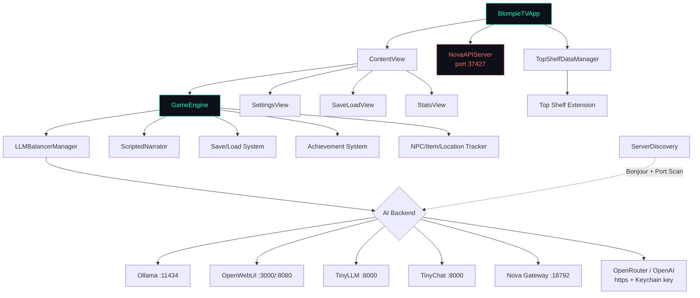
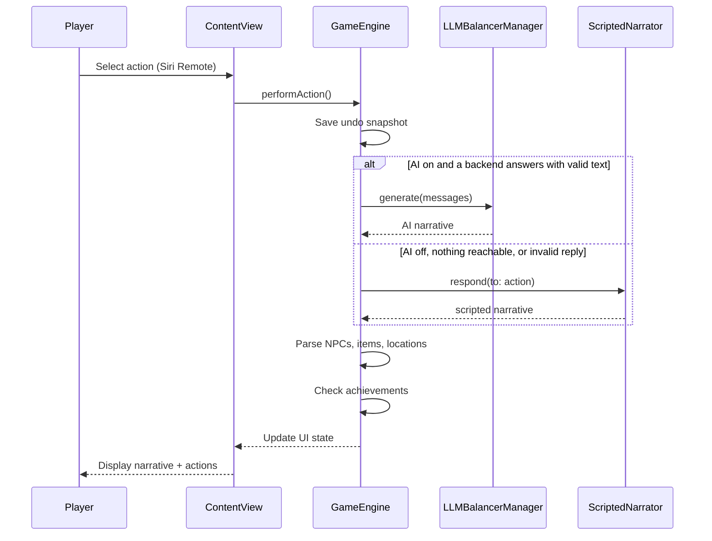
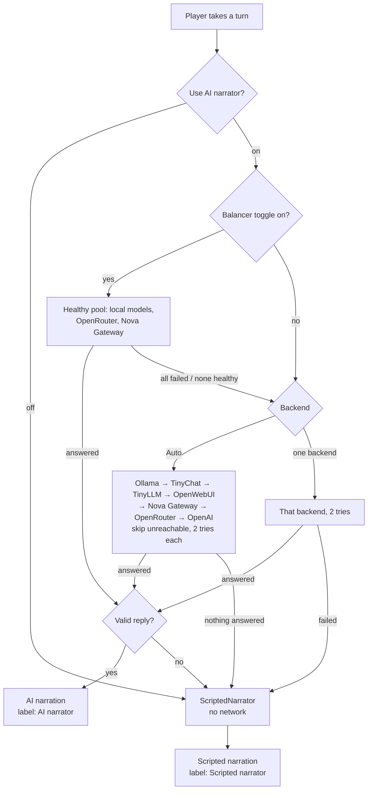

# BlompieTV


[](https://opensource.org/licenses/MIT)


An AI-powered text adventure game for Apple TV. BlompieTV brings classic Zork-style interactive fiction to the big screen, generating dynamic narratives in real time using large language models running on your local network. No cloud services required: your stories stay on your network, and when no AI is reachable (or AI is switched off) a built-in scripted narrator keeps the game playable.

Written by Jordan Koch.

---

## Architecture



### Gameplay Flow



---

## Features

### AI-Powered Storytelling
- Dynamic narrative generation using any local LLM (Mistral, Llama 3, Phi, and others)
- Configurable system prompt with detail level (Brief / Normal / Detailed) and tone (Serious / Balanced / Whimsical)
- Adjustable creativity temperature from 0.1 to 2.0
- Real-time streaming responses -- watch the story unfold token by token
- Token-per-second performance metrics displayed in the UI

### AI Backends
- **Auto** (default), **Ollama**, **TinyLLM**, **TinyChat**, **OpenWebUI**, **Nova Gateway**, **OpenRouter**, **OpenAI**. See [AI options](#ai-options).
- Built-in scripted narrator when AI is off or unreachable, so a turn is never lost
- **Random Model Mode** -- Automatically cycles between installed models every N actions for varied storytelling

### Network Service Discovery
- Bonjour/mDNS auto-discovery of AI servers on the local network
- Port scanning across common subnet ranges (192.168.x.x, 10.0.0.x)
- Manual server configuration with connection testing
- Real-time connection status indicator

### Game Mechanics
- 10 unlockable achievements (First Steps, Explorer, World Traveler, Social Butterfly, Diplomat, Collector, Hoarder, Conversationalist, Veteran Adventurer, Trader)
- Automatic NPC, item, and location tracking parsed from AI responses
- Inventory management displayed in a grid view
- Full undo system with up to 20 state snapshots
- Transcript export for reviewing past adventures

### Save System
- Multiple named save slots with timestamp and message count
- Autosave after every action (configurable)
- Save/load UI with delete and bulk-delete options
- Top Shelf extension shows save slots and game stats on the Apple TV home screen

### TV-Optimized Interface
- Focus-based navigation designed for Siri Remote
- Large monospaced typography (configurable 20pt to 48pt)
- Dark gradient background with subtle grid overlay
- Cyan accent color scheme with animated button states
- Split-panel layout: story text on the left, action buttons on the right
- Settings organized in tabbed sections (AI / Game / Model / Cloud)

### Local API Server
- HTTP API on port 37427 (loopback only, no external exposure)
- Endpoints: `/api/status` (app status and uptime), `/api/ping` (health check)
- Integration point for Nova (OpenClaw AI) and other local automation tools

### Top Shelf Extension
- Displays "New Adventure" and "Continue" quick-launch items
- Shows up to 3 save slot names
- Displays gameplay statistics (NPCs met, items found, locations visited)
- Data shared via App Group (`group.com.jordankoch.blompietv`)

---

## Requirements

### Hardware
- Apple TV 4K or Apple TV HD
- tvOS 17.0 or later

### AI Backend (optional; without one the scripted narrator runs)
- [Ollama](https://ollama.ai) (recommended) -- port 11434
- [OpenWebUI](https://openwebui.com) -- ports 3000 or 8080 (its API must accept requests without an API key; BlompieTV only sends keys to https cloud endpoints)
- [TinyLLM](https://github.com/jasonacox/TinyLLM) -- port 8000
- [TinyChat](https://github.com/jasonacox/tinychat) -- port 8000
- Nova Gateway -- port 18792 (also the route to Claude)
- OpenRouter or OpenAI -- your own API key, https only

### Recommended Models
- mistral
- llama3.2
- llama3.1
- phi
- codellama

Any model available through your AI backend will appear in the model picker.

---

## Installation

BlompieTV is distributed as a direct install via Xcode. It is not available on the App Store.

### Option 1: Build from Source

```bash
# Clone the repository
git clone git@github.com:kochj23/BlompieTV.git
cd BlompieTV

# Open in Xcode
open BlompieTV.xcodeproj
```

1. Select your Apple TV as the deployment target in Xcode.
2. Build and run (Cmd+R).
3. Xcode will deploy the app to your Apple TV over the network or via USB-C.

### Build Requirements
- macOS 14.0 or later
- Xcode 15.0 or later
- Apple Developer account (required for device deployment)
- Swift 5.0

---

## Setup

### 1. Start an AI Backend

#### Ollama (Recommended)
```bash
# Install Ollama
curl -fsSL https://ollama.com/install.sh | sh

# Pull a model
ollama pull mistral

# Start the server (if not auto-started)
ollama serve
```

#### OpenWebUI
```bash
docker run -d -p 3000:8080 \
  -v open-webui:/app/backend/data \
  ghcr.io/open-webui/open-webui:main
```

### 2. Network Configuration
- Both devices (Apple TV and AI server) must be on the same local network.
- Firewall must allow inbound connections on the relevant port (11434 for Ollama, 3000/8080 for OpenWebUI, 8000 for TinyLLM/TinyChat).

### 3. Configure BlompieTV
1. Launch BlompieTV. A game starts right away (scripted narrator until an AI backend is reachable).
2. Open **Settings > AI**. Use "Scan Network" to find Ollama/OpenWebUI, or type the server URL (e.g. `http://192.168.1.20:11434`) into the matching Endpoints field.
3. Pick a backend, or leave it on **Auto**.
4. Press **Test Connection**.
5. Choose your model in **Settings > Model**.

Settings saved by older versions (server address/port/type and model) are moved into the new settings automatically on first launch.

---

## AI options



| Setting | Where | Notes |
|---|---|---|
| **Use AI narrator** (on/off) | Settings > AI | Off: every turn comes from the built-in scripted narrator (a small hand-written world) and nothing is sent over the network. |
| **Backend** | Settings > AI | Auto, Ollama, TinyLLM, TinyChat, OpenWebUI, Nova Gateway, OpenRouter, OpenAI. MLX is macOS-only and not offered on tvOS. |
| **Endpoints** | Settings > AI | Editable URL for every local backend plus Nova Gateway and the OpenAI base URL. Defaults are `localhost`, which on an Apple TV means the TV itself, so enter your server's LAN address. |
| **Model** | Settings > Model | Lists the models of the selected backend (in Auto, the backend that answered last). |
| **Load balancing** | Settings > Cloud | Optional, off by default: all local Ollama models, all OpenRouter models, Nova Gateway. If the pool fails, the backend chosen above is used. |
| **API keys** | Settings > Cloud | OpenRouter and OpenAI only. See below. |

**Scripted fallback.** If AI is on but no backend answers (timeout, error, nothing reachable) or the reply fails the checks below, that turn is told by the scripted narrator instead. The turn is never lost and no error dialog appears. Scripted text isn't sent back to the model.

**Status.** The header shows a dot and a line: green "Narrator: Ollama online", orange "AI unreachable - scripted fallback", grey "AI off - scripted narrator", plus "Last turn: AI narrator (Ollama)" or "Last turn: Scripted narrator (...)". Settings > AI has the same status, a health dot per backend, and **Test Connection**.

**Timeouts and retries.** Health probes time out after 4 s and are cached for 30 s; generation requests time out after 120 s. Each backend gets at most 2 attempts (0.5 s backoff), and only transient errors (network errors, 408/429/5xx) are retried.

**Output checks.** Before a reply touches the game it is cleaned and checked: `<think>` reasoning and control characters are removed, empty or non-text replies and replies that echo the system prompt are rejected, the text is capped at 6,000 characters, and actions are capped at 6 items of 80 characters each with markdown and duplicates removed. A reply with no narrative is rejected.

**API keys.** OpenRouter and OpenAI keys are stored only in the Apple TV Keychain, under BlompieTV's own services `com.jordankoch.BlompieTV.openrouter` and `com.jordankoch.BlompieTV.openai`, never in UserDefaults or files. A request that carries a key is refused unless its URL is `https://`. Keys are never sent to local backends or used by status checks. A key saved by older versions under `com.jkoch.aistudio.openrouter` is moved to the new service on first launch.

**Entering a key on Apple TV.** In Settings > Cloud, select the key field: tvOS opens its on-screen keyboard. Typing a long key with the remote is slow, so use an iPhone signed in to the same Apple Account: when the field is focused the iPhone shows an "Apple TV Keyboard" notification (or open the Apple TV Remote in Control Center), where you can type or paste the key. Press **Save**. **Clear** deletes the key from the Keychain.

**Claude.** Claude is reached through Nova Gateway or through OpenRouter (e.g. `anthropic/claude-sonnet-4.5`); there is no separate Anthropic backend. Google Cloud, Azure, AWS and IBM Watson are not offered: in Jordan's other apps they were stubs or broken and never worked.

---

## Gameplay

### Controls (Siri Remote)
| Input | Action |
|---|---|
| Swipe / D-pad | Navigate between action buttons |
| Click / Select | Choose an action |
| Menu | Access Settings, Save/Load, and Stats |

### Tips
- The game autosaves after each action when auto-save is enabled.
- Use **Undo** to step back if you take a wrong turn.
- Try different models for distinct storytelling voices.
- Enable **Random Model Mode** in Settings to cycle between models automatically.
- Adjust **Detail Level** and **Tone** to shape the narrative style.
- Higher **Creativity** values produce more surprising (and occasionally wilder) prose.

---

## Project Structure

```
BlompieTV/
|-- BlompieTVApp.swift              App entry point, starts Nova API server
|-- GameEngine.swift                Core game logic, AI prompt construction,
|                                   turn flow (AI or scripted), response parsing,
|                                   save/load, achievements, undo, tracking
|-- ScriptedNarrator.swift          Offline scripted narrator, AI output
|                                   validation, AI/scripted source labels
|-- NovaAPIServer.swift             Local HTTP API (port 37427, loopback only)
|-- TopShelfDataManager.swift       App Group data sync for Top Shelf extension
|-- Services/
|   |-- LLMBalancerManager.swift    Backend picker, Auto failover, endpoints,
|   |                               models, Keychain keys, status, balancer
|   |-- LLMBalancerTypes.swift      LLMBackendType (canonical ids), LLMError
|   |-- ModelRegistry.swift         Model discovery + LoadBalancer
|   |-- OpenRouterProvider.swift    OpenRouter + OpenAI-compatible requests
|   |-- KeychainStore.swift         Keychain wrapper (+ one-time migration)
|   |-- Retry.swift                 Retry with backoff (from GTNW)
|   |-- OllamaService.swift         Ollama wire types + streaming client
|   +-- ServerDiscovery.swift       Bonjour/mDNS + port-scan server discovery
|-- Views/
|   |-- ContentView.swift           Main game UI (story panel, actions panel,
|   |                               header, toolbar, TV background and styles)
|   |-- SettingsView.swift          AI, game, model and cloud settings (tabbed)
|   |-- SaveLoadView.swift          Save/load slot management
|   +-- StatsView.swift             Statistics, achievements, inventory display
BlompieTVTopShelf/
+-- ContentProvider.swift           Top Shelf extension (save slots, stats)
```

---

## Nova / Claude API Integration

BlompieTV exposes a local HTTP API on port **37427** for integration with Nova (OpenClaw AI) and Claude Code.

**Platform:** tvOS
**Binding:** 127.0.0.1 only (no external network exposure)
**Auth:** `X-Nova-Token` header required for tvOS requests.

```bash
# Health check
curl -s http://127.0.0.1:37427/api/ping

# App status and uptime
curl -s http://127.0.0.1:37427/api/status | python3 -m json.tool
```

The API server starts automatically when the app launches.

---

## Third-Party Credits

- [TinyLLM](https://github.com/jasonacox/TinyLLM) by Jason Cox
- [TinyChat](https://github.com/jasonacox/tinychat) by Jason Cox
- [OpenWebUI](https://github.com/open-webui/open-webui) Community Project
- Inspired by classic text adventures, particularly Zork

---

## Version History

### v1.1.0 (November 2026) - AI options parity
- Global "Use AI narrator" switch and a scripted narrator that tells the turn when AI is off or unreachable
- Backend picker over the canonical set (Auto, Ollama, TinyLLM, TinyChat, OpenWebUI, Nova Gateway, OpenRouter, OpenAI) with editable endpoints and per-backend models
- Auto failover in a fixed order with health caching, timeouts and bounded retries
- Header status indicator and last-turn source label
- AI output validation
- OpenAI key support; OpenRouter key moved to BlompieTV's own Keychain service; keys are https-only
- Removed the unused AIBackendManager/AIBackendStatusMenu

### v1.0.0 (February 2026)
- Initial tvOS release
- Multi-backend support (Ollama, OpenWebUI, TinyLLM, TinyChat)
- Network service discovery (Bonjour + port scanning)
- Focus-based Siri Remote navigation
- Save/load system with multiple named slots
- 10 unlockable achievements
- NPC, item, and location tracking
- Streaming responses with token-per-second metrics
- Top Shelf extension with game state display
- Random Model Mode for varied storytelling
- Nova API server on port 37427

---

## Testing

The test suite (`BlompieTVTests`, 146 tests) runs on a tvOS simulator with no network (the AI tests use a stub HTTP transport, their own UserDefaults suite and their own Keychain service names):

```bash
xcodebuild test -project BlompieTV.xcodeproj -scheme BlompieTV -destination 'platform=tvOS Simulator,name=Apple TV 4K (3rd generation)'
```

### Test Coverage

| Category | Tests | Files | What's Covered |
|----------|-------|-------|----------------|
| **Unit** | 80 | `AIUnitTests`, `LoadBalancerTests`, `BlompieTVTests` | Backend ids and Auto order, endpoint validation, reply extraction, response parsing, output validation, scripted narrator world, settings persistence and migration, balancer pool/policies, models and codables |
| **Integration** | 14 | `AIIntegrationTests` | Auto failover order, explicit backend, per-backend endpoints, OpenRouter/OpenAI auth, status, model lists, balancer pool and fallback, Keychain migration |
| **Functional** | 10 | `AIFunctionalTests` | Whole turns with AI off, down, valid, invalid, recovering, toggled mid-game; long scripted playthrough; save/load |
| **Retry** | 16 | `RetryTests` | `firstSuccess` failover, `Retry` backoff, retry classification, bounded retries |
| **Performance** | 7 | `AIPerformanceTests` | Parse/validate cost, scripted narrator, balancer scaling, request timeouts, bounded cost of a dead network |
| **Security** | 15 | `AISecurityTests`, `SecurityTests` | Keychain-only keys under BlompieTV's services, https-only keys, no keys to local backends, AI off sends nothing, source scans, loopback-only API |
| **Frame** | 4 | `AIFrameTests` | Offscreen renders of the status indicator (each state) and the Settings tabs |
| **Total** | **146** | | |

---

## Author

**Jordan Koch**
GitHub: [@kochj23](https://github.com/kochj23)

---

## License

MIT License -- see [LICENSE](LICENSE) for full text.

Copyright (c) 2026 Jordan Koch.

---

> **Disclaimer:** This is a personal project created on my own time. It is not affiliated with, endorsed by, or representative of my employer.
